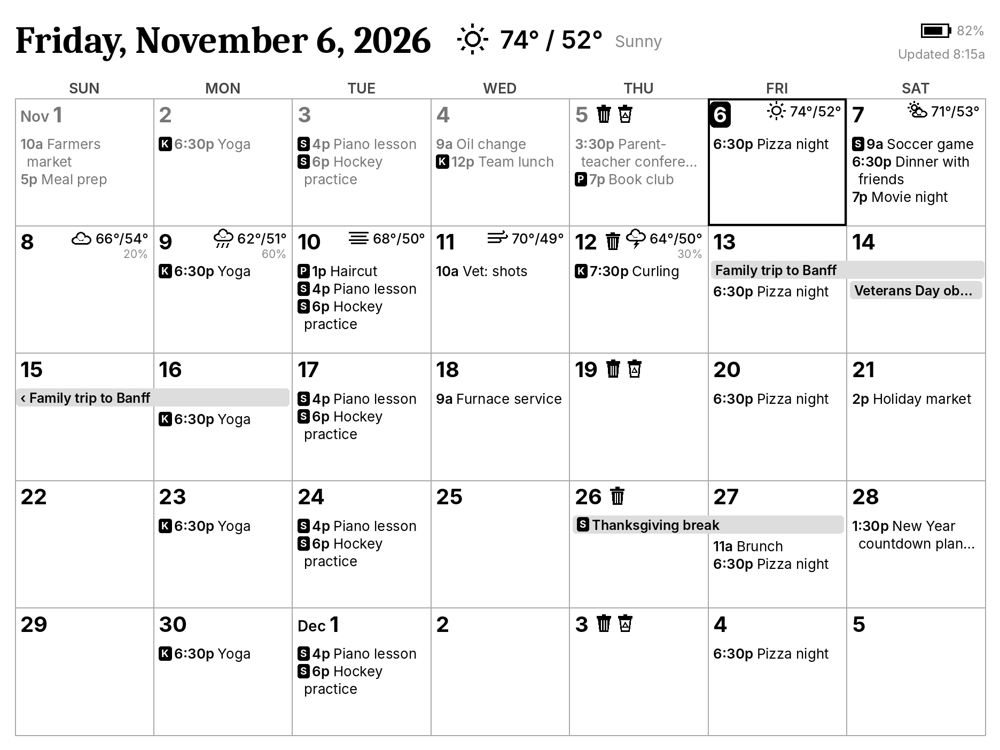

# E-Ink Family Calendar for Home Assistant

A battery-powered wall calendar on a 10.3" grayscale e-paper display. Home Assistant
pulls your Google calendars and the NOAA forecast, renders a rolling 5-week grid, and
publishes a new image only when something changed. The display wakes every 30 minutes,
asks whether there's anything new, redraws if so, and goes back to sleep.



## How it works

```
Google Calendar ─┐
(HA integration) │     ┌──────────────────────────────┐   status? (battery, hash)   ┌────────────────────┐
                 ├───▶ │ eink_calendar integration    │ ◀────────────────────────── │ reTerminal E1003   │
NOAA api.weather ┘     │  • fetch events + forecast   │ ──── redraw / sleep_s ────▶ │ ESPHome, deep sleep│
     .gov              │  • render 1872×1404 PNG      │ ◀──── GET image.png ─────── │ wakes every 30 min │
                       │  • publish only on change    │                             └────────────────────┘
                       └──────────────────────────────┘
```

- **Calendar changes or the date rollover** republish immediately; the display shows them at its next wake.
- **Weather-only changes** republish at most every 3 hours (configurable), since NWS revises forecasts often.
- **Quiet hours** (default 11 pm–6 am): the display sleeps straight through.
- **Green button** on the display: wake now, re-render, redraw.
- **Battery, signal and check-in times** are reported to HA on every wake.

## Hardware

Seeed **reTerminal E1003**: 10.3", 1872×1404, 16 gray levels, ESP32-S3 with 8 MB PSRAM,
3000 mAh battery. No soldering. See the bill of materials doc for parts, costs and the power budget.

## Install

### 1. Home Assistant integration

1. Set up the built-in **Google Calendar** integration so each calendar you want appears as a
   `calendar.*` entity. Share family members' calendars to that account, or add the integration once per account.
2. In HACS: **⋮ → Custom repositories**, add `https://github.com/HindsightEngineering/ha-eink-calendar`,
   category **Integration**, then install **E-Ink Calendar** and restart HA.
   (Without HACS: copy `custom_components/eink_calendar` into your HA `config/custom_components/`.)
3. **Settings → Devices & services → Add integration → E-Ink Calendar.** Pick the calendars,
   optionally a trash/recycling calendar (drawn as bin icons), then 1–3 character tags per calendar
   (drawn as black chips, e.g. `K`, `S`).
4. The last step shows a **device ID** and **token**. Keep them for the firmware. They're also shown later under **Configure**.

The integration adds an `image.<name>_calendar` entity, so you can preview exactly what the
display will show on any dashboard before the hardware arrives.

Weather uses NOAA for your HA home location (override latitude/longitude under Configure → advanced).
NOAA covers the US only.

### 2. Display firmware (ESPHome 2026.7.0 or later)

1. Copy `esphome/secrets.example.yaml` to `secrets.yaml` and fill in Wi-Fi, the HA LAN URL
   (`http://<HA IP>:8123`), and the device ID and token from step 4.
2. Flash `esphome/eink-calendar-e1003.yaml` over USB-C the first time:
   `esphome run esphome/eink-calendar-e1003.yaml` (or paste it into the ESPHome Builder add-on).
3. Later updates go over the air. Turn on the **Keep awake for update** switch in HA, wait for
   the next wake (or press the green button), flash, then turn the switch off.

The display needs to reach HA on port 8123. If it lives on an IoT VLAN, allow that.

## Options

| Option | Default | Notes |
| --- | --- | --- |
| Calendars | — | Any `calendar.*` entities; duplicate events across calendars are shown once |
| Trash / recycling calendar | none | Summaries containing "recycl" → recycle icon; "yard", "green waste", "compost" → leaf; else trash can |
| Temperature unit | °F | |
| Week starts on | Sunday | |
| Weeks shown | 5 | Rolling: always starts at the current week |
| Show end times | off | `6:30p-7:30p Yoga` instead of `6:30p Yoga` |
| Display check interval | 30 min | How often the display wakes outside quiet hours |
| Quiet hours | 23:00–06:00 | Same start and end disables them; the display then wakes just after midnight for the date rollover |
| Weather-only redraw gap | 3 h | |
| Calendar refresh interval | 10 min | How often HA re-reads calendars (advanced) |
| Image size | 1872 × 1404 | For other panels (advanced); layout scales with height |

## Security

The two endpoints (`/api/eink_calendar/<device_id>/status` and `/image.png`) skip HA's login
because the ESP32 can't do OAuth. Each is protected by a random per-device token; a wrong
token gets a bare 404. If your HA is reachable from the internet, anyone with the token can read
your calendar image. Treat the token like a password, and regenerate it by deleting and re-adding the integration.

## Development

```bash
pip install pillow pytest
python3 tools/preview.py --today 2026-11-06 --out preview.png      # sample data
python3 tools/preview.py --noaa 33.20,-117.24                      # live NOAA forecast (needs aiohttp)
pytest tests/test_core.py                                          # renderer, NOAA parser, policy

pip install pytest-homeassistant-custom-component
pytest                                                             # + config flow, views, entities on real HA core
```

`custom_components/eink_calendar/core/` has no Home Assistant imports, so the renderer and
NOAA client can be tested and previewed anywhere.

## Status and known gaps

- Integration: tested against Home Assistant 2026.2 core (config flow, options flow, HTTP views, entities, publish cycle).
- Firmware: validated with `esphome config` on ESPHome 2026.10.2 but **not yet compiled or run on hardware**. Things to check on first flash:
  - orientation (`transform` / `rotation` in the display block);
  - that the IT8951 doesn't blank the panel on a wake that doesn't redraw;
  - real battery drain (watch the voltage sensor for a week).

## License

MIT for the code. Bundled fonts (Inter, Caladea) are under the SIL Open Font License 1.1; see
`custom_components/eink_calendar/core/fonts/`.
